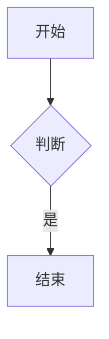

# Hexo-theme-Hybrid

把**个人主页**和 **Wiki 式笔记库**放进同一个 Hexo 主题。

站点首页是你的个人主页（名片、自述、最近更新），
笔记区则是另一套页面：左侧一棵目录树，展开即读。两套形态共用同一套设计系统。

## Features

- **三种页面模式** —— `home` 全宽个人主页 / `page` 常规页 / `wiki` 带目录树，由 front-matter 的 `layout` 决定
- **目录树导航** —— 由 `_posts` 的目录结构自动构建，可折叠、可过滤、自动展开到当前文章
- **个人主页数据驱动** —— 名片信息写在 `source/_data/profile.yml`，自述正文（背景、经历、技能）直接写在首页 Markdown，改内容不用碰模板
- **原生暗色模式** —— CSS 变量实现，默认跟随系统，可手动切换并记忆，无第三方依赖
- **文章内目录（TOC）** —— 自动生成、滚动高亮，不依赖渲染器的锚点实现
- **响应式** —— 宽屏侧栏常驻并可收起，窄屏变抽屉
- **多语言** —— 内置 10 种语言文件，界面文案（含 aria 标签、JS 文案）全部走 i18n，缺键回退到 `default.yml`
- **增强 Markdown** —— Mermaid 图表、KaTeX 公式、提示块、任务列表、脚注、emoji、上下标、缩写，
  全部交给成熟库渲染，主题只负责按需引入运行时与样式
- **B 站视频嵌入** —— 内置 `` 标签，BV / av 号、分 P、弹幕、比例都可调
- **分类只在一处展开** —— `/categories/` 是唯一的「主题 -> 文章」地图，`/notes/` 走时间线，首页只看精选

## Installation

```bash
cd your-hexo-site
git clone https://github.com/HUSTJJD/Hexo-theme-Hybrid.git themes/hybrid
```

或者用 submodule（推荐，便于跟随更新）：

```bash
git submodule add https://github.com/HUSTJJD/Hexo-theme-Hybrid.git themes/hybrid
```

然后在站点 `_config.yml` 里启用：

```yaml
theme: hybrid
```

建议把笔记列表从根路径挪走，把 `/` 让给个人主页：

```yaml
index_generator:
  path: notes      # 笔记列表迁到 /notes/
  per_page: 20
  order_by: -updated
```

## Usage

### 1. 个人主页

新建 `source/index.md`：

```markdown
---
title: 首页
layout: home
---

写一句自我介绍，会显示在 Hero 下方。
```

主页只保留 Hero 与自述正文：工作经历、教育经历、技能都写在 `source/index.md` 的自述里，
主题不再提供对应的独立模块，因此只需要一个数据文件：

| 文件 | 作用 |
| --- | --- |
| `source/_data/profile.yml` | 姓名、简介、联系方式 |

```yaml
# source/_data/profile.yml
name: 你的名字
tagline: 一句话简介
meta:
  - icon: map-marker
    text: 城市
  - icon: github
    text: GitHub
    url: 'https://github.com/you'
```

### 2. 笔记区

笔记照常放在 `source/_posts/`，**目录结构就是侧边栏的树**。
要在目录节点上能点进去，需要在该目录里放一个**同名的 Markdown**：

```
_posts
└── foo/            # 目录会成为树上的一个节点
    ├── bar.md
    └── foo.md      # 与目录同名的文件，作为该节点的落地页
```

### 3. 分类与笔记的分工

同一个内容不在三个地方各列一遍，三个入口各管一个视角：

| 入口 | 视角 | 内容 |
| --- | --- | --- |
| `/` | 精选 | 最近更新的几篇 + 个人名片 |
| `/notes/` | 时间 | 全量笔记流（按更新时间倒序，分页），顶部只有分类导航条 |
| `/categories/` | 主题 | 一级分区 -> 二级分类 -> 每个分区最新几篇 |

一级分类的中文名、描述、图标、配色写在主题配置的 `categories` 里（只需登记一级）：

```yaml
categories:
  - key: LLM
    name: LLM / 大模型
    desc: 大模型原理、训练与 Agent 工程化
    icon: brain
    color: violet     # violet | amber | blue | green | rose
```

二级分类由 `_posts` 的目录层级自动推导，不需要登记，配色会沿用所属的一级分类。

### 4. 页面模式

| `layout` | 形态 | 侧边栏 |
| --- | --- | --- |
| `home` | 全宽个人主页 | 无 |
| `page` | 常规页（关于、作品集…） | 无 |
| 未指定 / `wiki` | 常规页 | 有 |
| `post` | 笔记正文 | 有 |

任意页面都可以用 front-matter 强制开关侧边栏：

```yaml
wiki: true     # 强制带目录树
```

### 5. 配置

定制直接改主题源码（`_config.yml`、`layout/`、`source/css/`、`scripts/`），**不要用站点级补丁**
（根目录 `scripts/*.js` 覆盖钩子、`custom.css.path` 注入额外 CSS）。
理由：Hexo 的主题配置是 deepMerge，站点级只能覆盖键值、删不掉主题自带的项；靠 filter 和
额外 CSS 去打补丁，等于把一份定制拆散在三四个地方，改一处要记着另外几处。

唯一例外是**站点专属且不该进共用主题的信息**（站点图标、GitHub / 邮箱等外链账号）：
放站点根目录的 `_config.hybrid.yml`。

可配置项见 [`_config.yml`](_config.yml)：导航菜单、社交图标、外观、
分类分区、代码高亮、版权、页脚统计、giscus 评论、百度/谷歌统计、自定义 CSS/JS。

其中 `version` 是**发版开关**，改版后必须 +1：css/js 的 URL 会带上 `?v=<version>`
（浏览器重新拉取文件，不再吃旧缓存），同时本地缓存会统一换成
`hybrid:v<version>:*` 前缀，上一版残留的状态在启动时被清掉，深浅色与侧栏偏好自动迁移。

### 6. 增强 Markdown

这些能力来自 markdown-it 插件（构建期渲染），主题负责呈现与按需加载运行时。
需要站点先安装依赖：

```bash
npm i hexo-renderer-markdown-it markdown-it-emoji markdown-it-footnote \
      markdown-it-task-lists markdown-it-container markdown-it-deflist \
      markdown-it-abbr markdown-it-sub markdown-it-sup markdown-it-ins \
      markdown-it-mark @vscode/markdown-it-katex
```

并在站点 `_config.yml` 启用：

```yaml
markdown:
  plugins:
    - markdown-it-abbr
    - markdown-it-deflist
    - markdown-it-emoji
    - markdown-it-footnote
    - markdown-it-ins
    - markdown-it-mark
    - markdown-it-sub
    - markdown-it-sup
    - markdown-it-task-lists
    - name: markdown-it-container
      options: tip
    - name: markdown-it-container
      options: warning
    - name: markdown-it-container
      options: danger
    - name: markdown-it-container
      options: info
    - '@vscode/markdown-it-katex'
```

之后即可使用：

````markdown


行内公式 $E = mc^2$，独立公式：

$$
\nabla \cdot \mathbf{E} = \frac{\rho}{\varepsilon_0}
$$

:::tip
提示块，同样支持 :::info / :::warning / :::danger
:::

- [x] 已完成的任务
- [ ] 待办任务

脚注[^1] 与 emoji :tada:

[^1]: 脚注内容
````

Mermaid 只在页面**确实存在图表时**才从 CDN 加载（约 1 MB），没有图表的页面不会引入。
深浅色切换时图表会按 `theme` / `theme_dark` 重新绘制。

代码高亮建议用 **prismjs**：

```yaml
syntax_highlighter: prismjs
prismjs:
  enable: true
  line_number: true
```

prism 有 597 个语言组件（含 `hlsl`、`wgsl`、`unrealscript`、`glsl`），
且 hexo 会按需加载对应组件，新增语言无需改配置。
highlight.js 只有 192 种且缺少 hlsl / wgsl。

### 7. 内嵌 B 站视频

主题自带 `` 标签（简写 ``），不需要额外装插件，正文里前后留空行即可：

```markdown


                    # 第 2 分 P






```

| 参数 | 说明 | 默认 |
| --- | --- | --- |
| `p` / `page` | 分 P，也可以直接写第二个裸数字 | `1` |
| `danmaku` | `1` 开弹幕、`0` 关 | `0` |
| `ratio` | `16/9` 或 `4/3` | `16/9` |
| `hd` | 是否高清 | `1` |
| `title` | 播放器下方显示的文字 | 「在 B 站观看」 |

默认值可以在主题配置里改，播放器会按 `ratio` 自适应并保持比例，图片懒加载：

```yaml
plugins:
  bilibili:
    enable: true
    page: 1
    danmaku: false
    ratio: '16/9'
    high_quality: true
```

### 8. 多语言

切换语言只改站点配置：

```yaml
language: zh-CN
```

内置语言：`zh-CN`（简体）、`zh-TW`（正體）、`zh-HK`（繁體）、`en` / `default`（English）、
`ja`（日本語）、`de`（Deutsch）、`es`（Español）、`ru`（Русский）、`eo`（Esperanto）。

词条分这些组，命名即用途：

| 组 | 覆盖 |
| --- | --- |
| `home` / `notes` / `about` | 个人主页与笔记区 |
| `category` / `tag` / `archive` | 分类、标签、归档页 |
| `unit` | 计数单位（篇 / 分類 / tags…），跟在数字后面 |
| `search` / `footer` | 搜索框占位、页脚统计与署名 |
| `post` | 正文字数、上下篇、复制按钮、版权 |
| `aria` | `aria-label` / `title`，读屏器与 tooltip |
| `toc` | 目录树：收起 / 展开 / 打开索引笔记 |

规则：

- **缺键回退** —— 每种语言只需覆盖自己有的键，其余自动用 `default.yml`（English）
- **变量用 `%d` / `%s`** —— 例如 `__('notes.desc', site.posts.length)`；带链接的用 `<%- __('footer.powered', '<a …>Hexo</a>') %>`
- **JS 里的文案** —— 由 `layout.ejs` 注入到 `window.__hybrid.i18n`（`copy` / `copied` / `collapse` / `expand`），
  `js/main.js` 读它，取不到时按 `<html lang>` 回退，所以新增语言不用改 JS
- **日期** —— Hexo 的 `date()` 已按 `language` 设置 moment locale，`'LL'` 这类本地化格式会自动变成「2026年10月10日」

新增一种语言：复制 `languages/default.yml`，改名为 `<语言代码>.yml`（如 `fr.yml`），翻译后放在 `languages/` 下即可，
不需要注册。

已知不随语言切换的两处：

- `source/404.html` 是静态页（Hexo 直接拷贝，不走模板引擎），文案保持英文
- 顶栏菜单的文字写在站点配置 `menu` 里，属于站点内容，需要哪种语言就写哪种

## 与 Node-Tree 的差异

目录树引擎来自 [hexo-theme-node-tree](https://github.com/Exisi/hexo-theme-node-tree)，
在它之上做了这些定制：

- **去掉 PJAX** —— 多页面模式下各页 DOM 结构不同，无刷新加载会串味，改为整页加载
- **暗色模式改为原生实现** —— 原主题用 DarkReader（CDN + 运行时注入），这里换成 CSS 变量，
  不再依赖外部脚本，也没有刷新闪烁
- **样式全部重写** —— 独立的设计令牌（tokens / base / home / wiki），不引任何 CSS 框架
- **新增 home、page、archive、category、tag 布局**，并让侧边栏按模式开关
- **JS 全部判空** —— 个人主页没有侧边栏和目录树，所有模块都做了空值防御
- **TOC 不依赖渲染器锚点** —— 自建 slug 兜底，换 renderer 也不会失效
- **文案抽成 i18n** —— 原主题硬编码在模板里的文案改为语言文件

## Acknowledgements

Hybrid 的目录树引擎——树形结构构建、节点展开/折叠、节点过滤、文章内目录与图片灯箱——
来自 [**hexo-theme-node-tree**](https://github.com/Exisi/hexo-theme-node-tree)
by [Exisi](https://github.com/Exisi)，MIT 协议。非常感谢这个优秀的项目，
没有它就没有这套笔记浏览体验。

而 node-tree 本身又衍生自 [**hexo-theme-tree**](https://github.com/wujun234/hexo-theme-tree)
by wujun234，同样感谢。

主题图标与交互中用到的 [Font Awesome 4.7](https://fontawesome.com/v4.7.0/)，
以及 [Hexo](https://hexo.io) 本身。

## License

[MIT](LICENSE) © 2026 HUSTJJD

衍生自 hexo-theme-node-tree（MIT © 2024 Exisi），其原始许可声明保留在
[LICENSE-node-tree](LICENSE-node-tree)。
